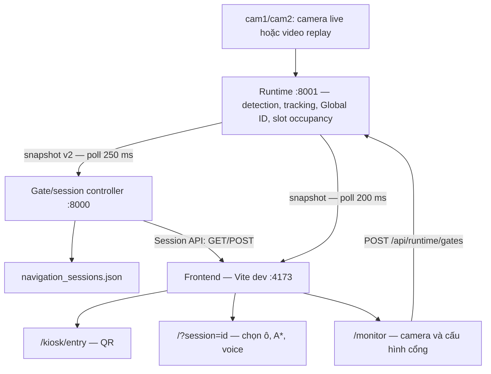

# TechGar2 — Báo cáo tổng hợp phân tích dự án

Smart Parking & In-Parking Navigation System · Ngày tổng hợp: 2026-10-04 · Workspace: `D:\TechGar2`.

## 1. Nguồn và phạm vi tổng hợp

Báo cáo được LEAD biên soạn từ output của ba builder Devin. LEAD chỉ giao việc, theo dõi, review báo cáo và tổng hợp; không tự đọc code, thực thi kiểm chứng kỹ thuật hay bổ sung phân tích code mới. Các dẫn chứng code dưới đây được giữ từ báo cáo builder.

| Builder | Phạm vi | Output nguồn | Review của LEAD |
|---|---|---|---|
| builder-a | Frontend, routing A*, bản đồ, Zustand, voice guidance, QR kiosk | [builder-a.md](builder-a.md) | Duyệt sau bổ sung vòng 1 |
| builder-b | Motion detection, MOT, SlotVehicleBinder, handoff hai camera, calibration | [builder-b.md](builder-b.md) | Duyệt sau bổ sung vòng 1 |
| builder-c | Gate/session, runtime API, cấu hình, vận hành, contract end-to-end và runbook | [builder-c.md](builder-c.md) | Duyệt sau cross-review và sửa hai chỗ còn sót ở vòng cuối |

Ký hiệu nguồn: **A §n**, **B §n**, **C §n** là mục trong ba file trên. “Đã chạy” chỉ áp dụng cho kiểm chứng builder thực sự báo đã chạy; các kết luận khác là phân tích tĩnh hoặc giả định được ghi rõ. Phân tích backend dựa trên working tree có thay đổi chưa commit, không đại diện riêng cho Git HEAD. Nguồn: B §1, §11.

## 2. Kiến trúc tổng thể

Hệ thống hiện có ba tiến trình: runtime xử lý hai camera và cung cấp HTTP API ở cổng **8001**; gate/session controller ở **8000**; frontend Vite dev ở **4173**. Frontend lấy snapshot trực tiếp từ runtime và lấy session từ controller qua proxy Vite. Giao tiếp dùng HTTP polling; không có WebSocket trong triển khai được builder xác minh. Nguồn: A §2–3; C §1–4.

Sơ đồ là cách trình bày lại các kết nối đã được A §3 và C §1–4 mô tả.

Frontend có bản đồ **SVG 1200×900**, **60 ô A01–F10**, sáu zone × mười ô. `cam1` quản lý D/E/F, ánh xạ `cam-left`; `cam2` quản lý A/B/C, ánh xạ `cam-right`. Builder-c đã đối chiếu geometry, config slot và ownership frontend, xác nhận cùng phân bố. Nguồn: A §3.1; B §5; C §4.5, §10.3.

Pipeline `main_detect` hiện dùng xử lý ảnh cổ điển: MOG2, temporal motion, contour, Kalman, LAPJV và appearance HSV/LAB. Theo builder-b, pipeline này không dùng YOLO/CNN; các model trong backend cũ không được pipeline hiện tại import. `use_deep_reid=True` bị từ chối bằng `ValueError`, nên DeepReID chưa được triển khai. Nguồn: B §2, §7; `cross_camera_manager.py:391–395` theo B.

## 3. Tech stack

Phiên bản frontend dưới đây là khai báo manifest, không phải khẳng định toàn bộ phiên bản đã cài chính xác.

| Tầng | Công nghệ / phiên bản | Nguồn |
|---|---|---|
| UI | React/react-dom `^19.0.0`, TypeScript `~5.7.2`, Vite `^6.0.5` | A §2; `frontend/package.json:1–47` |
| State và style | Zustand `^5.0.2`, Tailwind `^3.4.17`, CSS riêng | A §2–3 |
| QR / icon | qrcode `^1.5.4`, lucide-react `^0.468.0` | A §2 |
| Frontend tooling | pnpm `10.14.0`, Vitest `^3.2.4`, RTL `^16.1.0`, Playwright `^1.50.0` | A §2 |
| Runtime CV | Python; `opencv-python>=4.10`, `numpy>=1.26`, `lap>=0.5.12` | B §2; `backend/main_detect/requirements.txt` |
| Backend HTTP/session | Python stdlib: `ThreadingHTTPServer`, `urllib`, `threading`; session lưu JSON | C §1–2 |
| Backend test | `pytest>=9.0` theo manifest dev | B §2 |
| Python môi trường đã đo | **3.11.9**, từ `.venv/Scripts/python.exe --version` của builder-b | B §2; C §1 |

**Python tối thiểu yêu cầu chưa được xác minh.** C đã sửa suy luận từ `int | None`: các annotation dùng postponed annotations, nên riêng cú pháp đó không chứng minh phải ≥3.10. Phiên bản môi trường 3.11.9 được tách khỏi requirement tối thiểu. Nguồn: C §1, §10.6.

## 4. Module chính

| Module | Vai trò đã được builder mô tả | Nguồn |
|---|---|---|
| `geometry/parkingGeometry.ts`, `components/ParkingMap.tsx` | Geometry 60 ô; SVG, pan/zoom, route và marker xe | A §3.1 |
| `routing/laneGraph.ts`, `routing/routeEngine.ts` | Đồ thị làn có hướng; A*; route từ cổng hoặc vị trí xe | A §4 |
| `routing/recommendationEngine.ts` | Xếp hạng ô trống theo đường lái và khoảng cách đi bộ | A §4.6 |
| `stores/parkingStore.ts`, `stores/driverFlowStore.ts` | Trạng thái ô/camera và flow UI | A §3.2, §5 |
| `hooks/useVehicleSession.ts`, `domain/sessionParking.ts` | Poll/reconcile session, chống dữ liệu cũ, quyết định parked/reroute/pending | A §5 |
| `routing/voiceGuidance.ts`, `components/EntryQRKiosk.tsx` | Giọng nói tiếng Việt, off-route, QR phiên xe | A §6–7 |
| `two_camera.py`, `LatestFrameCapture` | Capture, đồng bộ hai camera, điều phối pipeline, recording/replay | B §3–4 |
| `ParkingDetector` | Occupancy ensemble 25 biến thể gamma × CLAHE, hysteresis | B §4.2, §4.5 |
| `MotionVehicleTracker` | Detection motion, Kalman, LAPJV, reacquire và occlusion | B §4.3–4.4 |
| `SlotVehicleBinder` | Gắn Global ID vào slot, arrival claim, departure token và recovery | B §4.6 |
| `CrossCameraManager`, `WorldTrajectoryMemory` | Local→Global ID, handoff, dormant ReID, merge/alias và quỹ đạo world | B §6 |
| `runtime_contract.py`, `runtime_server.py` | Snapshot v2; API runtime, gates, JPEG/MJPEG | B §5; C §2, §4 |
| `gate_session_controller.py`, `session_manager.py` | Entry/exit crossing, lifecycle session, reservation, revision/idempotency, lưu JSON | C §2–4 |

Tên module ngắn ở các hàng frontend nằm dưới `frontend/src/`; các lớp CV nằm trong `backend/main_detect/src/techgar/`. Đường dẫn và số dòng chi tiết được giữ trong báo cáo nguồn.

## 5. Luồng dữ liệu và hành vi chính

### 5.1 Camera → occupancy → identity → snapshot

1. Capture hai camera theo cơ chế latest-frame hoặc đọc replay có timestamp. Live sync mặc định giới hạn skew **120 ms**, tối đa ba lần catch-up. Nguồn: B §4.1; `two_camera.py:450–483`.
2. Parking worker mặc định khoảng **2 Hz**, hai thread, loại kết quả quá cũ hoặc evidence không monotonic. Kết quả vision được áp dụng trước bước cấp identity. Nguồn: B §4.2.
3. Motion detection kết hợp MOG2, temporal-motion mask, ROI, morphology/contour và occlusion guard. Kalman dự đoán, LAPJV gán detection→local track; appearance HSV/LAB hỗ trợ reacquire. Nguồn: B §4.3–4.4.
4. Occupancy dùng 25 phiếu gamma × CLAHE và dwell hysteresis. Slot chưa khởi tạo được xử lý theo hướng không coi unknown là free. Policy `vision_primary` để vision quyết định `occupied`; tracking gắn `vehicle_id`, không tự sửa occupancy vision. Nguồn: B §4.5–4.6; `slot_vehicle_binder.py:3840–3847`.
5. `CrossCameraManager` ánh xạ `(camera, local_id)` sang Global ID, hỗ trợ handoff overlap/edge, dormant ReID, merge/alias. Binder gắn identity vào slot bằng arrival claim hoặc strong-overlap dwell; departure token hỗ trợ tìm lại ID khi rời ô. Nguồn: B §4.6, §6.
6. Snapshot v2 được publish mặc định tối đa **5 Hz**, chứa xe, ô đỗ, geometry world, parking episode, pending confirmations, pipeline health, alias và events. Nguồn: B §4.7; C §4.1.

### 5.2 Entry → QR → chọn ô → parked → exit

Xe cắt ENTRY đúng chiều trên world map → controller tạo session gắn Global ID/runtime → kiosk lấy session waiting và sinh QR → trang cá nhân claim session → người dùng chọn ô → POST select → frontend tính A* và phát voice guidance. Parking evidence/episode cập nhật session sang `PARKED`; người dùng chọn chỉ lối ra → POST exit → `EXIT_NAVIGATION`; xe cắt EXIT đúng chiều → session bị xóa, GET trả 404 và UI kết thúc phiên. Nguồn: A §3.4; C §3, §10.4.

Kiosk ở **`/kiosk/entry`**; trang cá nhân ở **`/?session=<token>`**; monitor ở **`/monitor`**. `?session=ALL` là mô tả cũ. QR frontend/backend đều **120 giây**; docs ghi mười giây là stale. Backend trả `qrExpiresAt`; waiting list sort tăng theo `createdAt`, kiosk lấy phần tử cuối. Nguồn: A §2, §6; C §10.2, §10.4.

### 5.3 Routing, bản đồ và voice

Builder-a mô tả A* với chi phí cạnh Euclid và heuristic Euclid có scale theo chi phí cạnh. Đồ thị kiểm chứng có **103 node, 101 edge**; làn phải one-way, làn trái/giữa và connector two-way, cạnh vào ô one-way. Route từ vị trí xe chiếu lên cạnh drivable gần nhất, ngưỡng 60 đơn vị map, tuân theo chiều cạnh. Nguồn: A §4.1–4.3.

World→SVG dùng affine least-squares từ các slot có ID khớp, cần ít nhất ba anchor. Voice dùng Web Speech API `vi-VN`, cooldown/dedupe; App kiểm off-route với ngưỡng **80** và tự re-route. Nguồn: A §3.1, §7.

**Lỗi routing đã chạy xác minh:** route từ entrance tới ô thành công 60/60; `findExitRoute` từ ô ra cổng trả `null` **60/60**, vì spot-entry là node sink. Lỗi ảnh hưởng fallback khi không có vị trí xe; không có nghĩa mọi route ra từ vị trí xe đều thất bại. Script của A cho thấy `findExitRouteFromPos(840,450)` vẫn có route. Nguồn: A §4.4 và phụ lục; C §10.1.

### 5.4 Contract, freshness và nhịp polling

| Kênh | Nhịp / contract | Nguồn |
|---|---|---|
| Runtime snapshot | Schema v2, `runtime_id`, `frame_index`; publish mặc định ≤5 Hz | B §4.7; C §4.1 |
| Gate→runtime | Poll 250 ms | C §3 |
| Frontend→runtime | Poll 200 ms | A §3.3; C §3 |
| Frontend→session/reservations | Mỗi kênh 500 ms | A §5; C §3 |
| Kiosk→waiting | 250 ms | A §6; C §3 |
| Frontend→gate config | 1.000 ms | A §3.3; C §3 |
| Fetch frontend | Timeout 2.000 ms | A §8; C §3 |

Hai consumer gate và frontend yêu cầu schema v2, `source_mode="live"`, mọi camera online với `age_ms` từ 0 đến 5.000. `published_at` được kiểm theo cửa sổ xấp xỉ một giây tương lai đến năm giây quá khứ. Frontend còn kiểm cursor frame theo runtime và phát hiện không có frame mới quá năm giây. Dữ liệu không hợp lệ → gate ngừng xử lý, UI chuyển ô sang `unknown` và tạm dừng chỉ dẫn. Nguồn: A §5.2; C §4.1.

Session POST gửi `expected_revision` và `action_id`; backend kiểm revision và lưu receipt idempotency, frontend chống GET cũ ghi đè POST và reconcile sau lỗi. Canonical Global ID được theo chain `retired_global_ids` ở cả hai phía. Nguồn: A §5.1, §8; C §4.2, §4.5, §10.4.

FE dùng runtime snapshot, gates GET/POST và MJPEG. `/api/runtime/status`, `/map`, `/events` và ảnh `.jpg` không có consumer FE theo C; chúng vẫn là API backend, một số có test, không được mặc định coi là code chết. Nguồn: C §4.3 đã bổ sung sau review.

## 6. Cấu hình và vận hành

| Nhóm cấu hình | Nội dung / ràng buộc | Nguồn |
|---|---|---|
| Calibration shared map | Schema ≥5, reviewed/passed theo validation; homography khả nghịch; overlap polygon; topology hai camera cố định | B §5; `two_camera.py:284–331` |
| `parking_slots_cam1/2.json` | 30 slot/camera, ref 1280×720, polygon/center | B §5; C §10.3 |
| `roi_mask_cam1/2.json` | ROI mask, image size, một số override legacy | B §5 |
| `two_camera.detector.json` | Tuning detector per-camera | B §5 |
| `gate_zones.json` | ENTRY/EXIT world, direction, đơn vị `cm` khớp calibration hiện tại | C §4.4 |
| Session recordings | Raw/debug video, timestamp CSV, performance CSV, predictions v3, session_info v3 kèm config hash và Git revision | B §5 |

Trình tự vận hành C mô tả: chạy runtime → chạy frontend/mở monitor và cấu hình gate → khởi động controller với gate config đúng → mở kiosk/trang cá nhân. **Controller chỉ load gate config lúc khởi động**; khi vẽ lại cổng phải restart controller để áp dụng, trong khi FE tự poll gate config. Nguồn: C §3, §7-R6.

Hai vấn đề runbook replay có mức cao theo C:

- Lệnh replay trong `docs/lenh-chay-theo-session.md` thiếu `--live-mode`; snapshot `source_mode="replay"` bị gate/FE từ chối theo freshness contract. Nguồn: C §5-D1; `docs/lenh-chay-theo-session.md:124–165`.
- Các thư mục cấu hình session mà C đã liệt kê không có `gate_zones.json` được lệnh controller tham chiếu. Runbook cần nói rõ bước vẽ gate riêng cho session replay là điều kiện bắt buộc. Nguồn: C §5-D2; `docs/lenh-chay-theo-session.md:101–118,200–205`.

Đây là kết luận đối chiếu tĩnh code/docs và kiểm tra file của C, chưa phải kết quả chạy E2E replay.

## 7. Điểm mạnh và điểm yếu

### Điểm mạnh

- Contract snapshot có version, một producer chính; freshness và runtime identity được kiểm ở các consumer. Nguồn: B §8; C §6.
- Session có optimistic concurrency, idempotency, chống stale GET/POST; kiểm availability trong lock của process; ghi JSON atomic với fsync/replace. Nguồn: A §5.1; C §4.2, §6.
- Unknown/freshness/pending evidence được xử lý phòng thủ, có trạng thái pause và lỗi tiếng Việt. Nguồn: A §5.2–5.4; B §8.
- Có recording/replay, timestamp/config hash/Git revision, và nhiều unit test cho lỗi identity, binder, calibration, runtime. Nguồn: B §5, §7–8.
- Domain routing/resolver và nguồn mock có sự tách biệt với UI; SVG có hit layer và hỗ trợ pan/zoom. Nguồn: A §3, §9.

### Điểm yếu

- Module identity/binder lớn và nhiều heuristic: manager khoảng 7.8k dòng, binder khoảng 3.9k; topology mở rộng quá hai camera cần sửa code. Nguồn: B §3, §8.
- Occupancy `vision_primary` phụ thuộc detector pixel; lỗi vision kéo dài không được tracking trực tiếp sửa màu slot. Nguồn: B §8–9.
- Một camera mất stream có thể kết thúc toàn pipeline; chưa có vận hành degrade một camera trong đường chạy đã phân tích. Nguồn: B §4.1, §9-R2.
- Routing exit fallback, projection thiếu anchor và cập nhật vị trí gate không tính lại trọng số cạnh đều có vấn đề riêng. Nguồn: A §10-R1/R2/R3.
- Session file store chỉ phù hợp single-writer process theo phân tích C; chưa có reaper và có file I/O mỗi request. Nguồn: C §7-R2/R7/R10.
- Tài liệu mô tả nhiều thế hệ layout/QR/render/API khác triển khai hiện tại; chưa có kiểm chứng end-to-end camera thật trong đợt này. Nguồn: A §10–12; C §5, §9.

## 8. Rủi ro được builder ghi nhận

Mức ưu tiên giữ theo nguồn: A/B dùng Cao/Trung/Thấp; C dùng P1/P2/P3. LEAD không tự chấm lại mức ưu tiên. Các giả định chưa đo được không được nâng thành lỗi đã chứng minh.

| Rủi ro | Mức theo builder | Tác động / điều kiện | Bằng chứng và nguồn |
|---|---|---|---|
| Exit route từ ô là `null` | A: Cao | Mất route fallback khi thiếu vị trí xe; 60/60 ô thất bại | A §4.4, phụ lục; `laneGraph.ts:152–154`; C §10.1 |
| Projection fallback khi thiếu anchor | A: Cao | Clamp world→SVG có thể vẽ xe và dẫn đường sai mà không báo lỗi projection | A §10-R2; `worldToSvg.ts:85–89` |
| Occupancy phụ thuộc pixel/ánh sáng | B: Cao | Ô báo sai, ảnh hưởng binding/session/route; chưa đo tỷ lệ lỗi live | B §9-R1 |
| Một stream chết làm dừng pipeline | B: Cao | Snapshot dừng cập nhật, mất tracking toàn phiên | B §9-R2; `two_camera.py:2460–2481` |
| Replay không tạo session theo runbook | C: P1 | Gate/QR/nav không hoạt động do mode và gate config | C §5-D1/D2, §7-R1 |
| Không có reaper session | C: P1 | Session mất exit có thể tồn tại và giữ reservation; runtimeId scoping giảm rủi ro, nhưng `None` khớp mọi runtime | C §7-R2 |
| API không auth, CORS `*`, claim không kiểm QR expiry | C: P1; B: Thấp trong phạm vi LAN lab | Người truy cập được API có thể điều khiển session hoặc sửa gate; mức hai builder khác nhau theo phạm vi | C §7-R3; B §9-R8 |
| Lỡ exit crossing | C: P2 | Continuity ≤1 s, thiếu measured-path recovery cho exit; có thể để lại session | C §7-R4 |
| Gate load một lần; cạnh FE giữ distance cũ khi move gate | C: P2; A: Trung | Controller và giao diện có thể dùng gate khác nhau; metric route không được tính lại | C §7-R6; A §10-R3 |
| Clock giữa producer/consumer lệch | C: P2 | Freshness reject dữ liệu trên browser/host có clock lệch | C §7-R5 |
| Drift calibration, HSV/LAB ReID, departure recovery | B: Trung | Camera dịch chuyển, xe giống màu hoặc thiếu mẫu recovery có thể gây sai ID/world position | B §9-R3/R4/R5 |
| Nhiều process ghi cùng file session | C: P2 | Atomic write trong process không ngăn lost-update giữa process | C §7-R7 |
| Chi phí polling/render/file I/O | A: Thấp; C: P3 | Tăng tải khi nhiều client hoặc thiết bị yếu; chưa benchmark | A §10-R9; C §7-R10 |

Rủi ro wheel passive của A và exit collinear của simulator file mode của C được giữ là **giả định/chưa chạy xác minh**. TTL QR frontend/backend 120 s là **nhất quán**; bản thân docs ghi 10 s không chứng minh có mismatch TTL hệ thống. Nguồn: A §10-R4/R7; C §5-D11, §10.2.

## 9. Đề xuất cải tiến tổng hợp

Đây là đề xuất của builder, chưa được thực hiện trong nhiệm vụ phân tích.

| Nhóm | Đề xuất từ output builder | Nguồn |
|---|---|---|
| Routing / projection | Tạo đường ra hợp lệ từ spot-entry hoặc bắt đầu fallback ở aisle-junction; thêm test exit cho 60 ô. Khi không đủ affine anchor, ẩn marker/pause có cảnh báo. Tính lại edge distance khi move gate hoặc rebuild graph immutable. | A §11-1/2/3 |
| Runbook / demo | Bổ sung mode cần cho replay E2E, gate config per-session và bước restart controller sau đổi cổng; đồng bộ QR 120 s, kiosk URL, layout 60 ô, SVG và ngưỡng off-route 80. | C §8-1/8; A §11-4/9 |
| Session lifecycle | Reaper/TTL cho session mất xe hoặc không hoàn tất exit, giải phóng target reservation; bổ sung measured-path recovery cho exit. | C §8-2/3 |
| Quyền truy cập API | Hạn chế endpoint liệt kê session; kiểm QR expiry khi claim; kiểm soát POST gates, CORS/origin và API host. | C §8-4; B §10-6 |
| Runtime resilience | Retry/degrade per-camera thay vì dừng toàn phiên; giám sát evidence occupancy và drift calibration. | B §10-1/2/3 |
| Freshness / gate reload | Consumer đo thời gian từ frame cursor mới bằng clock cục bộ; không so monotonic clock giữa host. Controller reload gate config khi thay đổi. | C §8-5/6 |
| Bảo trì và mở rộng | Hoàn thiện WIP departure-recovery cùng test/metric offline; trừu tượng topology camera; chuyển log hot path; làm rõ flag legacy và interface appearance extractor nếu triển khai DeepReID. | B §10-4/5/7/8 |
| Hiệu năng / UX | Memoize theo frame/spot changes, cache session reads, xử lý overlay reservation cũ; cải thiện timeout/retry POST bằng idempotency sẵn có. | A §11-6/8/10; C §8-9 |

## 10. Review, kiểm chứng và giới hạn

### Kết quả builder báo đã thực thi

| Builder | Kiểm chứng trong nhiệm vụ | Kết quả / giới hạn |
|---|---|---|
| A | Script routing dùng esbuild và node; cwd `D:\TechGar2\.analysis`; lệnh `node check-routing.mjs` | 103 node, 101 edge; inbound 60/60; exit-from-slot 0/60; có ví dụ route-from-position thành công. Không chạy pnpm test/lint/build/Playwright. |
| B | Cwd `D:\TechGar2\backend\main_detect`; `.\.venv\Scripts\python.exe -m pytest -q` | **448 passed in 7.88s**. Unit test có mock/giả lập, không chứng minh E2E camera thật. Python trực tiếp đo 3.11.9. |
| C | Đọc/list/count file/config và đối chiếu code/docs/contracts | Không chạy runtime/test/API/hardware. Dùng kết quả A/B với nguồn rõ trong cross-review. |

Nguồn: A §1, §12 và phụ lục; B §1–2; C §9–10. Kết quả validation frontend cũ được A đọc từ artifact không được tính là test chạy trong nhiệm vụ này.

### Nội dung đã yêu cầu sửa sau review

- B bổ sung cwd/lệnh pytest/output và Python đo trực tiếp; sửa nhận định `__pycache__` tracked thành không tracked, được ignore. Nguồn: B §1–2, §8.
- A xác nhận QR FE/BE cùng 120 s, hạ nhận định wheel chưa test thành giả định, bổ sung hướng tái lập script. Nguồn: A §6, §10, phụ lục.
- C bổ sung cross-review với A/B, sửa consumer `/status`, phân biệt lệnh đọc/list với runtime/test, tách Python môi trường khỏi minimum, sửa đề xuất freshness đa host. Nguồn: C §1, §4.3, §8–10.
- Hai chỗ Python minimum còn sót trong D9 và đề xuất docs của C đã được builder-c sửa ở vòng cuối; LEAD đã đọc lại và xác nhận đồng bộ với kết luận minimum chưa xác minh.

### Theo dõi block và giới hạn còn lại

Trong quá trình điều phối, B từng chờ quyền chạy lệnh liệt kê; A/C từng chờ quyền chạy lệnh kiểm chứng. LEAD chỉ đọc trạng thái, không gửi phê duyệt hay bật bypass cho builder. Các builder sau đó tiếp tục và nộp output; không có phần phân tích nào bị bỏ trống do block kéo dài khi hoàn tất.

Đợt này chưa đo FPS/latency thật, precision/recall occupancy, tỷ lệ ID switch/handoff trên camera, hành vi voice/wheel trên trình duyệt/điện thoại hoặc cloud deployment. Không chạy toàn hệ thống live hay E2E replay. Một số nhánh heuristic sâu, component trình bày và docs phụ được builder đọc có chọn; giới hạn đầy đủ ở A §12, B §11, C §9. Đề xuất trong báo cáo chưa phải thay đổi code hay xác nhận production readiness.
